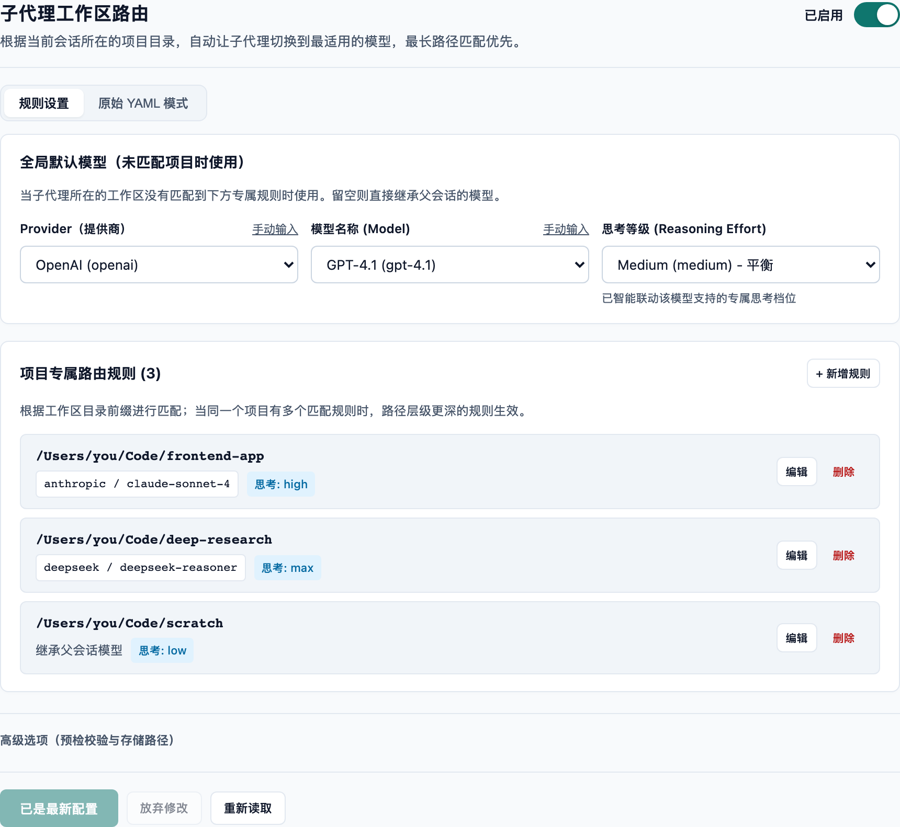
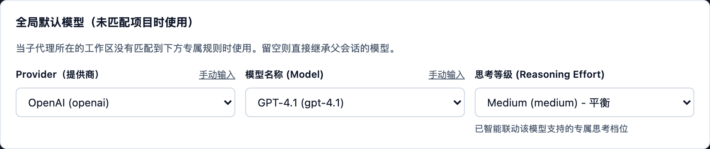
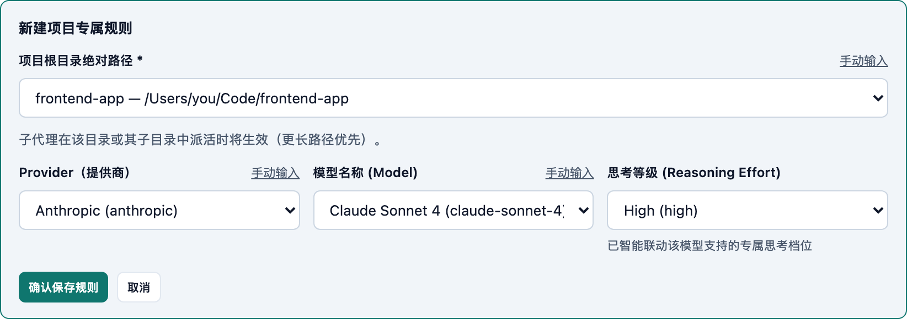
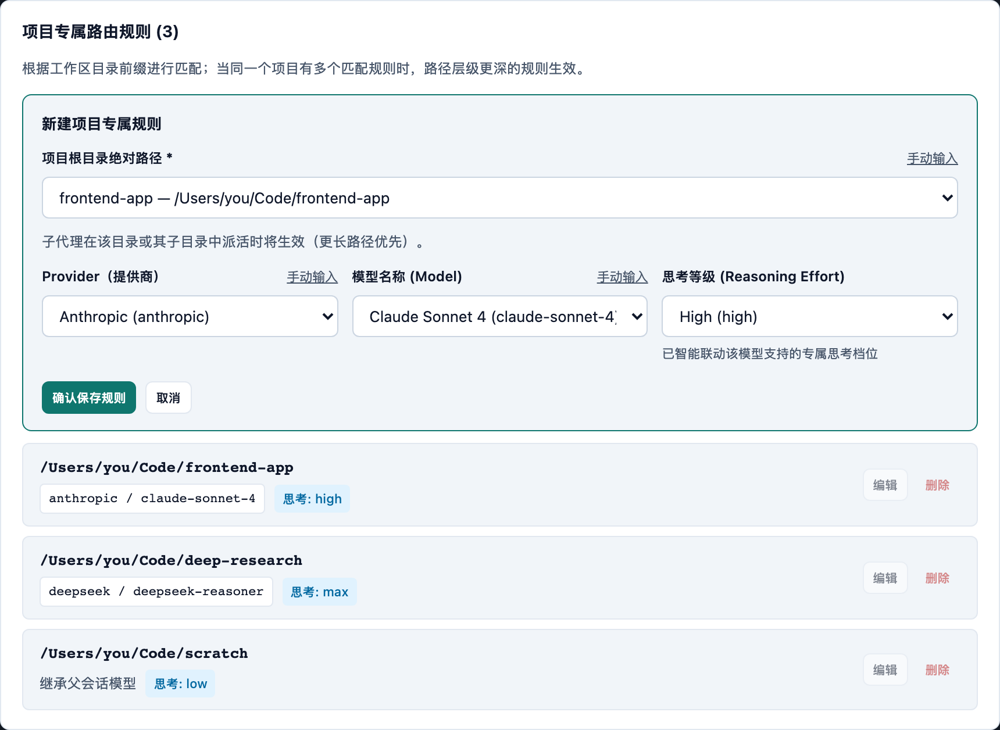
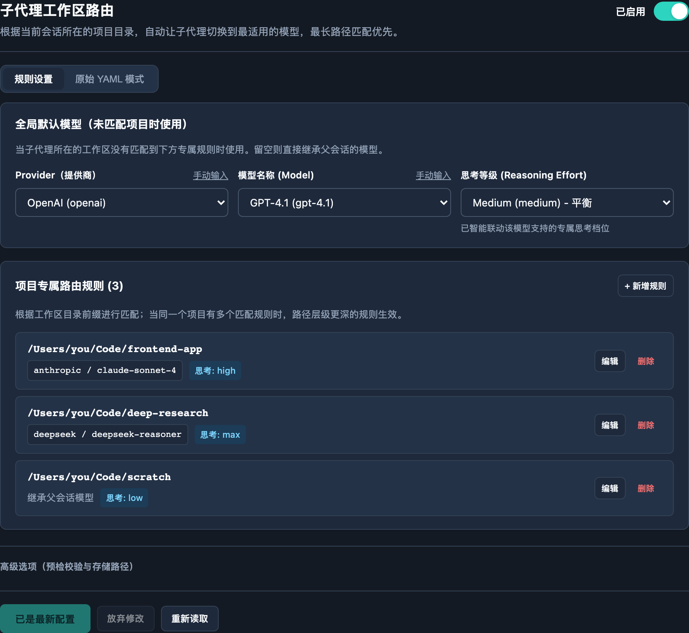

# dsh-subagent-routes

> 按工作区目录给子智能体指定 **provider / 模型 / 思考等级** 的 DeepSeek Harness 插件。

子代理的模型路由原本只有三档：工具实例的静态 `agentOptions`、会话级的
`subagent-model-selection` 白名单、具名子代理库的逐条目配置——**没有按工作区
（项目目录）区分**。本插件补上这一档：你在哪个项目里干活，子代理就用那个项目
配好的模型，全程不用每次派活手动指定。



> 截图由 [`scripts/capture-readme-screenshots.mjs`](scripts/capture-readme-screenshots.mjs)
> 在隔离浏览器中渲染**已构建的** client 产物生成，宿主接口全部走内存 mock；
> 图中的项目路径、提供商与模型均为合成示例，不代表任何真实环境。

---

## 目录

- [解决什么问题](#解决什么问题)
- [安装](#安装)
- [快速开始](#快速开始)
- [界面说明](#界面说明)
- [工作原理](#工作原理)
- [优先级规则](#优先级规则)
- [路由表格式与手动配置](#路由表格式与手动配置)
- [插件配置项](#插件配置项)
- [验证与排错](#验证与排错)
- [已知边界](#已知边界)
- [开发](#开发)
- [隐私说明](#隐私说明)

---

## 解决什么问题

| 场景 | 没有本插件 | 有本插件 |
|---|---|---|
| 前端项目用强模型写代码 | 每次派活手动挑模型 | 进入 `~/Code/frontend-app` 自动用 |
| 长文档研究用最大思考等级 | 反复设置 reasoning effort | 目录命中后自动带上 `max` |
| 临时脚本用便宜模型 | 容易忘记切换 | 按目录前缀自动落到低配 |
| 一个仓库里不同子目录不同策略 | 无法表达 | 最长前缀匹配，深层覆盖浅层 |

路由只作用于**新派活**的子代理；对已经在跑的会话不做任何改动。

---

## 安装

```sh
# 从本地目录安装
dsh plugin --profile desktop add /path/to/dsh-subagent-routes

# 或从 npm 安装（发布后）
dsh plugin --profile desktop add @zdt3476/dsh-subagent-routes
```

首次安装、或从没有 client 的旧实现升级后，需**重载插件或重启 DSH**，
确保宿主加载新的 client 能力；仅打开旧设置页不会补载新入口。
若重载后仍无设置入口，请重启 DSH。

安装后设置入口出现在 **插件管理 → 本插件 → 设置**，bundle 卡片与
patch 插件行均提供入口。

---

## 快速开始

三步就能跑起来，全程不需要手写 YAML：

1. **打开设置页**：插件管理 → 本插件 → 设置。
2. **（可选）设全局默认模型**：没匹配到任何项目时用它兜底；留空则继承父会话模型。
3. **添加项目规则**：点「+ 添加项目规则」→ 从**工作区下拉**选项目 → 从**模型下拉**选模型 →
   思考等级会自动跟着模型联动 → 「确认保存规则」→ 底部「保存所有更改」。

保存后**下一次新派活立即生效**，不需要重启 DSH。

---

## 界面说明

### 全局默认模型



未命中任何项目规则时使用；留空表示直接继承父会话当前模型。

### 三级联动选择：不用背任何 ID

Provider、Model、思考等级全部从**宿主已探测的列表**里选：

- **Provider**：列出当前 profile 里已配置的全部提供商。私有通道可点「手动输入」自行录入。
- **Model**：默认就是下拉列表。未选 Provider 时按厂商分组列出全部模型，选中即自动回填所属 Provider。
  选项内部同时编码 `provider + model`，因此不同厂商的同名模型不会互相覆盖。
- **思考等级**：跟随所选模型的真实元数据。
  - 模型不支持推理 → 选项禁用并清空，避免把非法等级写进配置。
  - 模型支持推理 → 只列出该模型的专属档位；原值不被支持时自动落到该模型推荐的默认档。
  - 手动输入的未知模型 ID → 保留你已选的等级，插件不做擅自改写。

### 项目规则：路径也走选择



「项目根目录」默认从**宿主已登记的工作区**里挑（显示为「标题 — 路径」），
不用手抄长路径；需要填 `~/...` 或更细的子目录时，点「手动输入」随时切回。

规则列表把「目录 → 模型 → 思考等级」压成一眼能读的卡片，支持单条编辑与删除：



- 只配了思考等级、没配模型的规则会标注「继承父会话模型」。
- 正在编辑的那条会高亮，底部保存按钮同时置灰并提示先确认，防止未提交内容丢失。

### 原始 YAML 模式

偏好代码编辑或要批量粘贴时，右上角可切到「原始 YAML 模式」。
可视化表单与 YAML 双向同步，保存时校验结构。

### 深浅色主题



---

## 工作原理

所有创建子代理的入口（`subagent`、`subagent_fork`、`workflow`、`agent-team`、
具名子代理库的 `delegate`）最终都调用 `ctx.subagents.startActivation`。
插件只在**这一处**介入，因此天然覆盖全部派活路径，不用改 DSH 本体：

1. 读父会话的**当前工作目录**（`workingDirectory` 投影优先，回落到会话头 `cwd`）；
2. 在路由表里做**最长前缀匹配**；
3. 把匹配到的 provider / model / reasoningEffort 合并进 `request.agentOptions`；
4. 按需调用 `llm.resolveCallConfig()` 预检，路由非法时在派活处直接失败。

派活时不写会话事件、不改 profile；只有**用户保存基础配置**时才会通过宿主
`configEditor.edit` 持久化到当前 profile，并校验、重载插件。
卸载时删除路由拦截的自有属性，派活行为回到原生。

---

## 优先级规则

**调用方显式指定 > 工作区路由 > 父会话继承**

- 调用方显式给了 `provider` + `model`（模型自己选的，或具名子代理条目配的）→ 插件完全让位，
  连思考等级也不追加：那是给工作区模型配的等级，套到另一个模型上可能不被支持。
- 调用方只给了 `reasoningEffort` → 插件只补 provider / model，保留其等级。
- 都没有 → 插件注入完整路由；换路由且没指名等级时，丢弃继承自父会话的等级，
  让新模型用自己默认的（与 DSH `resolveChildAgentOptions` 的语义一致）。

---

## 路由表格式与手动配置

路由表默认位置 `$DSH_HOME/subagent-routes.yaml`（通常是 `~/.dsh/subagent-routes.yaml`）。
可视化设置页就是它的编辑器；也可以直接手写：

```yaml
# 可选的全局兜底：没有目录命中时使用
default:
  provider: openai
  model: gpt-4.1
  reasoningEffort: medium

routes:
  - path: ~/Code/frontend-app
    provider: anthropic
    model: claude-sonnet-4
    reasoningEffort: high
  - path: ~/Code/frontend-app/legacy    # 更长前缀优先
    provider: deepseek
    model: deepseek-chat
  - path: ~/Code/research
    reasoningEffort: max                # 只改等级，provider/model 继承父会话
```

字段规则：

| 字段 | 说明 |
|---|---|
| `path` | 必填，绝对路径或以 `~` 开头；尾部分隔符会被规范化掉 |
| `provider` + `model` | 必须同时出现或同时省略 |
| `reasoningEffort` | 适配器自有的等级 id（`low` / `medium` / `high` / `max` 等，取决于模型） |
| 三者至少要有一个 | 否则该条目没有意义 |

改路由表后，**下一次新派活即生效**：每次派活都会重读文件，不需要重启。

---

## 插件配置项

在 profile 的 `cordis.patch.yml` 里按 id 覆盖。注意：同 id 的 override 会替换**整个**
`config`，三个字段要写全：

```yaml
- id: subagent-routes
  config:
    routesFile: ~/.dsh/subagent-routes.yaml
    enabled: true
    preflight: true
```

| 字段 | 默认 | 说明 |
|---|---|---|
| `routesFile` | `$DSH_HOME/subagent-routes.yaml` | 路由表路径；留空用默认位置 |
| `enabled` | `true` | 路由注入开关；`false` 时停止注入，设置入口仍保留 |
| `preflight` | `true` | 注入前用 `llm.resolveCallConfig` 校验路由；关掉则把错误留到子会话首轮 |

这三项在设置页里分别对应「已启用 / 已暂停」开关与折叠的「高级选项」，
改完点底部「保存所有更改」即可，无需手工编辑 profile。

---

## 验证与排错

派活后看 DSH 日志：

```
subagent-routes: /Users/you/Code/frontend-app → anthropic/claude-sonnet-4 @high
```

或者看子会话的模型标识。

路由表写错时，日志会给出**行号级**的说明，并且该次派活按「无路由」继续，
不会阻塞工作。常见报错：

| 现象 | 原因 |
|---|---|
| `路由条目的 path 必须是绝对路径` | 写了相对路径；补全绝对路径或改成 `~` 开头 |
| `provider 与 model 必须同时出现或同时省略` | 只写了一半 |
| `路由表重复声明了目录` | 同一路径写了两条 |
| `含未知字段` | 字段名拼错（如 `reasoning_effort`） |
| 派活前预检失败 | provider / model / 等级组合不被该适配器支持；可在高级选项里临时关掉 preflight |

---

## 已知边界

- **只影响新派活**：已经运行中的子代理不会被重新路由。
- **fork 子代理同样适用**：`fork` 会继承父会话的对话前缀，换模型会让这段前缀的
  provider 侧缓存失效，属于预期代价。
- **前缀匹配是纯字符串的**：不做 realpath，符号链接和 `..` 不会自动归一。
- **工作区与模型列表来自宿主**：宿主没提供对应服务（或该 profile 尚未登记工作区）时，
  设置页会自动退回手动输入，功能不受影响。
- 需要 `@deepseek-ai/cordis` 的 `symbols.original` 取回真实服务实例；若未来 cordis
  改变服务包装方式，这里需要同步（代码中有明确断言与告警）。

---

## 开发

```sh
pnpm install
pnpm test          # 类型检查 + 单元测试
pnpm run build     # 构建 lib/（host ESM + client CJS）
pnpm run check     # test + build
```

仓库结构：

```
src/
  host/            # Host 侧：拦截 startActivation、路由匹配、设置读写接口
  client/          # 浏览器侧：设置面板、联动选择器、样式
  shared/          # 两侧共享的契约与 YAML 工具
tests/             # 与 src 对应的单元/集成测试
scripts/
  verify-settings.mjs              # 隔离验收：几何、对比度、键盘焦点、状态机
  capture-readme-screenshots.mjs   # 生成本 README 的截图
```

两张验收脚本都在隔离浏览器里加载**已构建的** `lib/client.js`，所有宿主接口由
内存 mock 提供，不接触真实 profile：

```sh
pnpm run check
NODE_PATH=/opt/homebrew/lib/node_modules node scripts/verify-settings.mjs
NODE_PATH=/opt/homebrew/lib/node_modules node scripts/capture-readme-screenshots.mjs
```

---

## 隐私说明

本仓库不含任何真实凭据、私有网关地址或用户配置：

- 截图与测试中的提供商、模型、路径均为**合成示例**（`acme-*`、`/Users/you/...`）；
- 没有 API key、token、cookie 或个人信息；
- 运行时配置（路由表）位于用户的 `$DSH_HOME`，不进仓库。

## 许可证

[MIT](LICENSE)
